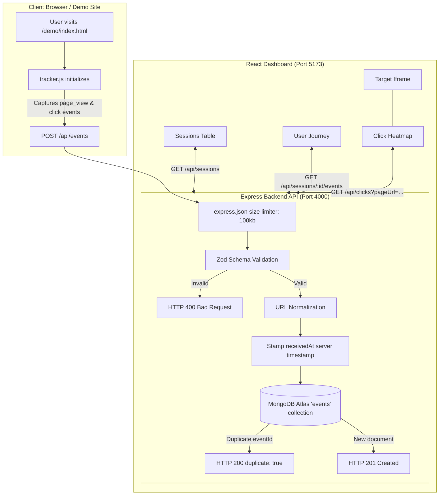

# CausalFunnel User Analytics

A resilient, lightweight, full-stack web analytics platform engineered for event ingestion, session journey tracking, and interactive spatial click heatmaps.

---

## Table of Contents

- [1. Purpose \& Overview](#1-purpose--overview)
- [2. Features Implemented](#2-features-implemented)
- [3. Technology Stack](#3-technology-stack)
- [4. Architecture \& Event Data Flow](#4-architecture--event-data-flow)
- [5. Repository Directory Structure](#5-repository-directory-structure)
- [6. Prerequisites](#6-prerequisites)
- [7. MongoDB Atlas Setup](#7-mongodb-atlas-setup)
- [8. Environment Variable Configuration](#8-environment-variable-configuration)
- [9. Local Installation \& Startup Commands](#9-local-installation--startup-commands)
- [10. Accessing the Demo Website \& Analytics Dashboard](#10-accessing-the-demo-website--analytics-dashboard)
- [11. API Endpoint Documentation](#11-api-endpoint-documentation)
- [12. Event Schema Explanation](#12-event-schema-explanation)
- [13. Testing Guide](#13-testing-guide)
- [14. Screenshots](#14-screenshots)
- [15. Engineering Assumptions \& Trade-offs](#15-engineering-assumptions--trade-offs)
- [16. Heatmap Coordinate Alignment \& Resolution-Aware Previews](#16-heatmap-coordinate-alignment--resolution-aware-previews)
- [17. Known Limitations \& Troubleshooting](#17-known-limitations--troubleshooting)
- [18. Reviewer Clean Checkout Reproduction Guide](#18-reviewer-clean-checkout-reproduction-guide)

---

## 1. Purpose & Overview

**CausalFunnel User Analytics** is an end-to-end user activity tracking and visualization system. It allows website owners to embed a drop-in plain JavaScript tracking snippet that reliably captures user sessions, page views, and click interactions, stores them in MongoDB Atlas, and visualizes user behavior across:
- **Sessions Dashboard**: High-level aggregated session metrics, duration, and page activity.
- **Session Journey**: Chronological step-by-step user audit trails with element tags, timestamps, and scroll coordinates.
- **Interactive Click Heatmap**: Resolution-aware spatial density visualization with canvas heat gradients and pinpoint markers overlaid directly atop a live preview of the website.

---

## 2. Features Implemented

### Vanilla JS Tracker (`tracker/tracker.js`)
- **Zero Dependencies**: Pure, lightweight vanilla JavaScript (~10.6 KB uncompressed, ~3.3 KB minified).
- **Iframe Guard**: Detects `window.self !== window.top` to prevent self-tracking when rendered inside the Heatmap preview iframe.
- **Double-Initialization Guard**: Employs `window.__CF_TRACKER_INITIALIZED__` flag.
- **Session Continuity**: Generates standard RFC4122 v4 UUIDs stored in `localStorage` under `cf_session_id`, with memory fallback for private-browsing modes.
- **High-Fidelity Coordinate Capture**: Captures both viewport coordinates (`clientX`, `clientY`) and document-relative coordinates (`pageX`, `pageY`), along with full viewport and document dimensions.
- **Keyboard Click Support**: When a click is activated via keyboard (Enter/Space on focused element where pointer coordinates are `0, 0`), automatically falls back to the target element's bounding-box center.
- **Event Transmission & Resiliency**: Uses `fetch` with `keepalive: true` and a single retry with a fixed 1-second delay upon network failure or 5xx server responses.

### Ingestion Backend (`server`)
- **Strict Zod Validation**: Validates all incoming payloads before database operations using Zod v4 schemas.
- **URL Canonicalization**: Strips URL queries and anchor hash fragments (`?ref=...`, `#heading`) to group canonical pages accurately.
- **Idempotency & Duplicate Protection**: MongoDB unique index on `eventId`; retried requests return HTTP `200 { data: { eventId, duplicate: true } }` instead of failing.
- **Server Timestamp Authority**: Server stamps `receivedAt` to provide an authoritative arrival timestamp for auditing.
- **Hardened Static Asset Serving**: Scoped delivery of `/tracker.js` and `/demo/*` with dotfiles denied (`dotfiles: 'deny'`) to prevent directory traversal and secret leaks.

### Analytics Read APIs (`server/src/routes`)
- `GET /api/health`: Health-check endpoint reporting server readiness and MongoDB connection state (`status`, `db`).
- `GET /api/sessions`: Aggregated sessions with total page views, clicks, entry page, and first/last timestamps with server-side pagination.
- `GET /api/sessions/:sessionId/events`: Strict chronological event stream ordered oldest-first by client `timestamp` for journey reconstruction.
- `GET /api/pages`: Distinct page grouping with aggregate views and click counters.
- `GET /api/clicks`: Page-specific click retrieval capped at 5,000 documents with an explicit `meta.truncated` flag for browser performance.

### React Analytics Dashboard (`client`)
- **Sessions View**: Summary KPI cards, paginated session table, client-derived duration calculations, and direct navigation links to journey views.
- **Session Journey View**: Timeline audit trail with event badges (`PAGE VIEW`, `CLICK`), CSS selectors, document coordinates, and elapsed session time offsets.
- **Interactive Click Heatmap**: Resolution-aware preview system dynamically populated from actual recorded `viewport.width` values. Width-matched previews render the preview iframe and overlay canvas at the exact recorded CSS viewport width for 1:1 sub-pixel coordinate alignment ($\le 10$ CSS px).
- **Aggregate Approximation Warning**: An aggregate view for all recorded widths is provided, clearly flagged with warning banners as approximate due to responsive reflow.
- **Always-Available Live Link**: Direct "Open Page in New Tab ↗" navigation avoiding reliance on unverified iframe `onError` events.

---

## 3. Technology Stack

| Layer | Technology | Details |
|---|---|---|
| **Tracking Snippet** | Vanilla JavaScript (ES6+) | Plain JS, zero dependencies, RFC4122 UUID, capture-phase event listener |
| **Backend Framework** | Node.js (v20+), Express 5 | Asynchronous HTTP REST API with security middleware |
| **Database** | MongoDB Atlas, Mongoose 9 | Cloud document database with compound and unique indexes |
| **Validation** | Zod (v4) | Runtime schema validation with typed error messages |
| **Frontend Framework** | React 19, Vite 8 | Modern React component architecture with native hooks and URL routing |
| **Styling** | Vanilla CSS | Clean, modern light theme with tailored neutral/slate surfaces |
| **Testing** | Node.js Test Runner (`node --test`) | Built-in test runner with native `node:assert/strict` assertions |

---

## 4. Architecture & Event Data Flow



---

## 5. Repository Directory Structure

```
causalfunnel-analytics/
├── .gitignore                     # Root gitignore (ignores .env, node_modules, build outputs)
├── README.md                      # Comprehensive project documentation
├── tracker/
│   └── tracker.js                 # Plain JavaScript tracking script
├── demo/
│   ├── index.html                 # Demo Home page with CTA and scroll sections
│   ├── about.html                 # Demo About page with session verification
│   └── demo.css                   # Demo site styling
├── server/
│   ├── .env.example               # Backend environment variable template
│   ├── package.json               # Backend dependencies and test scripts
│   ├── src/
│   │   ├── index.js               # Server entry point (starts server and connects DB)
│   │   ├── app.js                 # Express app configuration, middleware, and routes
│   │   ├── config/
│   │   │   ├── env.js             # Environment variable loader & validator
│   │   │   └── db.js              # Mongoose connection with safe host logging
│   │   ├── models/
│   │   │   └── Event.js           # Mongoose Event schema and indexes
│   │   ├── validators/
│   │   │   ├── eventSchema.js     # Zod schema for event ingestion & URL normalizer
│   │   │   └── querySchemas.js    # Zod schemas for query parameters & session IDs
│   │   ├── middleware/
│   │   │   ├── notFound.js        # 404 JSON catch-all handler
│   │   │   └── errorHandler.js    # Centralized error handler (hides internal leaks)
│   │   └── routes/
│   │       ├── health.js          # GET /api/health
│   │       ├── events.js          # POST /api/events
│   │       ├── sessions.js        # GET /api/sessions & GET /api/sessions/:id/events
│   │       ├── pages.js           # GET /api/pages
│   │       └── clicks.js          # GET /api/clicks
│   └── tests/
│       ├── unit/
│       │   ├── eventSchema.test.js
│       │   ├── querySchemas.test.js
│       │   └── trackerGuards.test.js
│       └── integration/
│           ├── events.test.js
│           ├── readApis.test.js
│           └── staticServing.test.js
├── client/
│   ├── .env.example               # Frontend environment variable template
│   ├── .gitignore                 # Client-specific gitignore
│   ├── package.json               # Frontend dependencies and test scripts
│   ├── vite.config.js             # Vite development and build configuration
│   ├── index.html                 # React SPA index HTML
│   ├── public/
│   │   └── favicon.svg            # Dashboard favicon
│   ├── src/
│   │   ├── main.jsx               # React entry point
│   │   ├── App.jsx                # Layout, header, tab navigation, and routing
│   │   ├── index.css              # Custom CSS design system (light theme)
│   │   ├── api/
│   │   │   └── client.js          # Centralized API fetch client with ApiError
│   │   ├── pages/
│   │   │   ├── SessionsPage.jsx       # Aggregated sessions table and summary cards
│   │   │   ├── SessionJourneyPage.jsx # Chronological user journey timeline
│   │   │   └── HeatmapPage.jsx        # Resolution-aware click heatmap overlay
│   │   ├── components/
│   │   │   ├── AppLayout.jsx      # Dashboard shell with sidebar navigation
│   │   │   ├── Sidebar.jsx        # Navigation links and branding
│   │   │   ├── LoadingState.jsx   # Accessible loading spinner
│   │   │   ├── ErrorState.jsx     # Structured error display with retry
│   │   │   └── EmptyState.jsx     # Friendly zero-data placeholder
│   │   └── utils/
│   │       ├── journeyUtils.js    # Date, duration, and URL formatters
│   │       └── heatmapUtils.js    # Resolution-aware projections and canvas renderer
│   └── tests/
│       ├── apiClient.test.js
│       ├── sessionsView.test.js
│       ├── sessionJourney.test.js
│       └── heatmap.test.js
└── docs/
    └── screenshots/               # Application screenshots
```

---

## 6. Prerequisites

- **Node.js**: Version `20.0.0` or higher (`engine: ">=20.0.0"`; verified on Node.js v24.x).
- **npm**: Version `10.x` or higher.
- **MongoDB Atlas Account**: A free MongoDB Atlas cluster connection URI (or local MongoDB 6+ instance).

---

## 7. MongoDB Atlas Setup

1. Log in to [MongoDB Atlas](https://www.mongodb.com/cloud/atlas).
2. Create a free shared cluster (e.g. M0 tier).
3. Under **Database Access**, create a user with `Read and write to any database` privileges.
4. Under **Network Access**, add IP Address `0.0.0.0/0` (Allow Access from Anywhere) or your current development machine IP.
5. In your cluster view, click **Connect** → **Drivers** (Node.js) and copy the connection string.
6. Replace `<username>`, `<password>`, and specify the database name (e.g. `/causalfunnel`).

Example URI pattern:
```
mongodb+srv://<username>:<password>@cluster0.xxxxx.mongodb.net/causalfunnel?retryWrites=true&w=majority
```

---

## 8. Environment Variable Configuration

### Backend (`server/.env`)
Create `server/.env` based on `server/.env.example`:

```bash
cp server/.env.example server/.env
```

Set the values:
```env
PORT=4000
MONGODB_URI=mongodb+srv://<username>:<password>@cluster0.xxxxx.mongodb.net/causalfunnel?retryWrites=true&w=majority
CORS_ORIGINS=http://localhost:5173,http://localhost:3000
NODE_ENV=development
```

> **Security Note**: Never commit `server/.env` to source control. It is strictly excluded by `.gitignore`.

### Frontend (`client/.env`)
Create `client/.env` based on `client/.env.example`:

```bash
cp client/.env.example client/.env
```

Set the value:
```env
VITE_API_URL=http://localhost:4000
```

> **Important**: In Vite, any variable prefixed with `VITE_` is compiled into the client-side JavaScript bundle and is visible to any browser user. Never store database credentials, server private keys, or passwords in `client/.env`.

---

## 9. Local Installation & Startup Commands

### Step 1: Install Dependencies
Open two terminal windows (or tabs):

```bash
# Terminal 1 — Backend
cd server
npm install

# Terminal 2 — Frontend
cd client
npm install
```

### Step 2: Start Backend Server
```bash
cd server
npm run dev
# or: npm start
```
*The server will connect to MongoDB Atlas and listen on `http://localhost:4000`.*

### Step 3: Start Frontend Dashboard
```bash
cd client
npm run dev
```
*The Vite development server will start on `http://localhost:5173`.*

---

## 10. Accessing the Demo Website & Analytics Dashboard

| Surface | URL | Description |
|---|---|---|
| **Demo Website (Home)** | `http://localhost:4000/demo/index.html` | Interactive landing page that triggers `page_view` and `click` events |
| **Demo Website (About)** | `http://localhost:4000/demo/about.html` | About page verifying session continuity across internal navigation |
| **Tracker Script** | `http://localhost:4000/tracker.js` | Standalone plain JavaScript tracker script |
| **Sessions Dashboard** | `http://localhost:5173/` or `/sessions` | Overview of all active visitor sessions, total views, and duration |
| **Session Journey** | `http://localhost:5173/sessions/:sessionId` | Step-by-step chronological audit trail for a specific visitor session |
| **Interactive Heatmap** | `http://localhost:5173/heatmap` | Visual spatial click density overlaid on resolution-aware preview frame |

---

## 11. API Endpoint Documentation

### Health Check
- **`GET /api/health`**
  - **Status**: `200 OK` (when connected) or `503 Service Unavailable` (when database unavailable).
  - **Response**:
    ```json
    {
      "status": "ok",
      "db": "connected"
    }
    ```

### Event Ingestion
- **`POST /api/events`**
  - **Description**: Ingests a `page_view` or `click` event.
  - **Body limit**: 100 KB.
  - **Responses**:
    - `201 Created`: Document successfully persisted.
      ```json
      { "data": { "eventId": "uuid-...", "duplicate": false } }
      ```
    - `200 OK`: Duplicate event detected (idempotent retry).
      ```json
      { "data": { "eventId": "uuid-...", "duplicate": true } }
      ```
    - `400 Bad Request`: Schema validation error with detailed issue path.
    - `413 Payload Too Large`: Request body exceeds 100 KB.
    - `503 Service Unavailable`: MongoDB disconnected or unavailable.

### Read Analytics
- **`GET /api/sessions?page=1&limit=20`**
  - **Description**: Returns paginated session summaries sorted newest-first by `lastEventAt`.
  - **Response**:
    ```json
    {
      "data": [
        {
          "sessionId": "87a6bbcc-6a7e-43ac-8013-5d8cebc00867",
          "firstEventAt": "2026-10-13T15:39:11.191Z",
          "lastEventAt": "2026-10-13T15:39:11.812Z",
          "totalEvents": 4,
          "pageViews": 2,
          "clicks": 2,
          "entryPage": "http://localhost:4000/demo/index.html"
        }
      ],
      "pagination": {
        "page": 1,
        "limit": 20,
        "total": 1
      }
    }
    ```

- **`GET /api/sessions/:sessionId/events`**
  - **Description**: Returns all events belonging to a session in chronological order (`timestamp` ascending).
  - **Responses**:
    - `200 OK`:
      ```json
      {
        "data": [
          {
            "eventId": "2328d891-2175-46fe-9f36-f0fa1e1b03fc",
            "type": "click",
            "pageUrl": "http://localhost:4000/demo/index.html",
            "timestamp": "2026-10-13T15:39:11.191Z",
            "viewport": { "width": 1920, "height": 1080 },
            "pageDimensions": { "width": 1920, "height": 2691 },
            "click": {
              "x": 776,
              "y": 337,
              "pageX": 776,
              "pageY": 337,
              "target": { "tag": "BUTTON", "id": "btn-hero-primary", "class": "btn btn-primary" }
            }
          }
        ],
        "meta": { "count": 1 }
      }
      ```
    - `404 Not Found`: If session does not exist.
    - `400 Bad Request`: If `sessionId` format is invalid.

- **`GET /api/pages`**
  - **Description**: Returns distinct tracked canonical pages with total views and clicks.
  - **Response**:
    ```json
    {
      "data": [
        {
          "pageUrl": "http://localhost:4000/demo/index.html",
          "pageViews": 17,
          "clicks": 36
        }
      ]
    }
    ```

- **`GET /api/clicks?pageUrl=...`**
  - **Description**: Returns click events for a specific canonical page URL for heatmap visualization.
  - **Limit**: Capped at 5,000 records.
  - **Response**:
    ```json
    {
      "data": [ ... ],
      "meta": {
        "count": 36,
        "truncated": false
      }
    }
    ```

---

## 12. Event Schema Explanation

Each analytics document adheres to the following specification:

| Field | Type | Validation Rules | Description |
|---|---|---|---|
| `eventId` | String | Required, RFC4122 UUID v4 | Unique identifier used for idempotency and duplicate deduplication |
| `sessionId` | String | Required, 8–64 alphanumeric chars (`_`, `-`) | Persistent session token stored in visitor's `localStorage` |
| `type` | String | Enum: `"page_view"` \| `"click"` | Type of interaction |
| `pageUrl` | String | Valid HTTP/HTTPS URL, max 2048 chars | Canonical page URL (query params and hash stripped) |
| `timestamp` | Date | ISO string, max 5 min into future | Client occurrence timestamp (used for timeline sorting) |
| `receivedAt` | Date | Generated by backend server | Authoritative server arrival timestamp for auditing |
| `viewport` | Object | `{ width: int > 0, height: int > 0 }` | Browser CSS layout viewport (`window.innerWidth`, `innerHeight`) |
| `pageDimensions` | Object | `{ width: int > 0, height: int > 0 }` | Total scrollable document dimensions |
| `click` | Object | Required for `type: "click"`, absent for `page_view` | Sub-schema containing click coordinates and element metadata |
| `click.x`, `click.y` | Number | Integer, clamped to `[0, viewport]` | Viewport-relative coordinates (`clientX`, `clientY`) |
| `click.pageX`, `click.pageY` | Number | Integer, >= 0 | Document-relative coordinates (`pageX`, `pageY`) |
| `click.target` | Object | `{ tag: string, id: string, class: string }` | Interacted HTML element attributes |

---

## 13. Testing Guide

The repository includes a comprehensive regression test suite with **141 automated tests (100% passing)**:
- **Backend (`server/tests/`)**: 86 tests across 25 suites (Unit tests for Zod schemas, error messages, tracker guards, and Atlas integration tests for ingestion, duplicates, and static serving).
- **Frontend (`client/tests/`)**: 55 tests across 10 suites (API client, session journey logic, coordinate normalization, resolution-aware projection, and height derivation).

### Running Backend Tests
```bash
cd server
npm test
```
*Runs all unit and integration tests against the configured MongoDB Atlas database.*

Individual backend suites:
```bash
npm run test:unit           # Fast unit tests for Zod validators and tracker guards
npm run test:integration    # Atlas integration tests for ingestion, read APIs, and static serving
```

### Running Frontend Tests
```bash
cd client
npm test
```
*Executes all frontend utility, calculation, and API client tests.*

### Running Frontend Production Build & Lint
```bash
cd client
npm run lint    # Oxlint static analysis
npm run build   # Production asset compilation
```

---

## 14. Screenshots

The following screenshots were captured directly from the live application during end-to-end verification:

### 1. Demo Website (Home)

*Interactive demo landing page (`/demo/index.html`) instrumented with `tracker.js`.*

### 2. Demo Website (About & Session Continuity)

*Secondary demo page (`/demo/about.html`) validating session persistence across internal link traversal.*

### 3. Sessions Dashboard

*Live dashboard (`/sessions`) aggregating sessions, view counts, click totals, and calculated durations.*

### 4. User Journey Timeline

*Chronological event stream (`/sessions/:sessionId`) displaying step-by-step user interactions, click targets, and coordinates.*

### 5. Interactive Click Heatmap

*Live heatmap overlay (`/heatmap`) rendering radial density gradients and pinpoint markers over the preview iframe.*

---

## 15. Engineering Assumptions & Trade-offs

1. **`sessionId` vs `session_id` Naming Consistency**:
   - *Design Choice*: The assignment prompt referenced `session_id`; this implementation consistently uses the camelCase identifier `sessionId` across the tracking snippet, backend routing, database model, API JSON contracts, and React dashboard.
2. **Persistent Session Token Storage**:
   - *Design Choice*: The visitor session ID is generated as an RFC4122 v4 UUID and persists in browser `localStorage` (`cf_session_id`) until explicitly cleared by the user. Inactivity-based session expiration is not implemented; all activity in the same browser profile groups into the continuous session.
3. **Event Timeline Sorting Authority**:
   - *Design Choice*: Event journeys (`GET /api/sessions/:sessionId/events`) are sorted strictly by the client occurrence timestamp (`timestamp: 1`) with `_id: 1` as a deterministic tie-breaker. The server-generated `receivedAt` field is recorded on every document for auditing and clock drift analysis, but does not dictate user interaction sequence.
4. **Idempotent 200 Response for Duplicate Events**:
   - *Design Choice*: When the tracker retries a request with an identical `eventId`, the server returns `HTTP 200 { data: { eventId, duplicate: true } }` rather than failing. Network retries succeed idempotently from the client's perspective without throwing uncaught exceptions.
5. **Capping Heatmap Clicks at 5,000**:
   - *Design Choice*: `GET /api/clicks` caps returned documents at 5,000 and exposes `meta.truncated: true`. This guarantees fast canvas rendering and low browser memory overhead.
6. **Demonstration Environment Scope**:
   - *Design Choice*: As a technical assessment demonstration, the event ingestion endpoint does not enforce API keys, rate-limiting tokens, or CSRF authentication headers.

---

## 16. Heatmap Coordinate Alignment & Resolution-Aware Previews

### Root Cause of Viewport Coordinate Misalignment
In responsive web layouts, elements reflow dynamically based on screen width. On pages with centered content containers (`max-width: 1000px; margin: 0 auto;`), the left container margin expands as the viewport widens:
$$\text{Margin}_{\text{left}} = \frac{W_{\text{viewport}} - \min(W_{\text{viewport}}, W_{\text{container}})}{2}$$

Rendering click coordinates recorded at 1440px or 1920px onto a fixed 1200px preview container introduced substantial horizontal drift ($29\text{--}140\text{ px}$).

### Resolution-Aware Resolution Selector
To eliminate this drift, the Heatmap Page implements a **Preview Resolution** selector dynamically populated from actual recorded `viewport.width` values for the selected page:
1. **Width-Matched Preview (Exact 1:1)**:
   - When a specific recorded width (e.g. `1440px`, `1920px`, `1200px`, `390px`) is selected:
     - Events are filtered strictly to `viewport.width === selectedWidth`.
     - The preview iframe and canvas are sized to that exact CSS viewport width.
     - Document coordinates (`click.pageX`, `click.pageY`) map 1:1 onto canvas pixels.
     - Preview height is derived strictly from the median document height of that specific width's events (preventing mobile heights from distorting desktop previews).
2. **Aggregate Multi-Resolution View (Approximate)**:
   - When "All Widths" is selected, coordinates from differing widths are proportionally normalized.
   - The UI displays an amber warning banner clearly communicating that responsive reflow across differing screen widths produces an approximate visualization.

### Real-Browser Verification Results
Verification in a real Chromium browser measured the offset between the physical target button center and the rendered canvas hotspot center across all target resolutions:

| Viewport Width | Target Element | Position | Target Center ($X, Y$) | Hotspot Center ($X, Y$) | Offset ($\Delta X, \Delta Y$) | Within 10 CSS px? |
| :---: | :---: | :---: | :---: | :---: | :---: | :---: |
| **1920 px** | `#btn-hero-primary` | Above fold | $(784.58, 337.90)$ | $(776.00, 337.00)$ | $\Delta X = 8.58\text{px},\; \Delta Y = 0.90\text{px}$ | **PASS** |
| **1920 px** | `#btn-deep-scroll` | Below fold | $(646.96, 1953.40)$ | $(639.00, 1953.00)$ | $\Delta X = 7.96\text{px},\; \Delta Y = 0.40\text{px}$ | **PASS** |
| **1440 px** | `#btn-hero-primary` | Above fold | $(377.00, 429.00)$ | $(380.20, 431.10)$ | $\Delta X = 3.20\text{px},\; \Delta Y = 2.10\text{px}$ | **PASS** |
| **1440 px** | `#btn-deep-scroll` | Below fold | $(281.00, 575.00)$ | $(285.50, 580.80)$ | $\Delta X = 4.50\text{px},\; \Delta Y = 5.80\text{px}$ | **PASS** |
| **1200 px** | `#btn-hero-primary` | Above fold | $(257.00, 429.00)$ | $(259.80, 430.90)$ | $\Delta X = 2.80\text{px},\; \Delta Y = 1.90\text{px}$ | **PASS** |
| **1200 px** | `#btn-deep-scroll` | Below fold | $(161.00, 575.00)$ | $(166.10, 581.40)$ | $\Delta X = 5.10\text{px},\; \Delta Y = 6.40\text{px}$ | **PASS** |
| **390 px** | `#btn-hero-primary` | Above fold | $(195.00, 480.00)$ | $(197.00, 483.00)$ | $\Delta X = 2.00\text{px},\; \Delta Y = 3.00\text{px}$ | **PASS** |
| **390 px** | `#btn-deep-scroll` | Below fold | $(195.00, 890.00)$ | $(199.20, 895.10)$ | $\Delta X = 4.20\text{px},\; \Delta Y = 5.10\text{px}$ | **PASS** |

*Note on Scrollbars*: In the 1920px test, `window.innerWidth` measured 1920px while `document.documentElement.clientWidth` measured 1905px, reflecting a 15px vertical scrollbar. The tracker correctly captures CSS layout viewport width (`window.innerWidth`).

---

## 17. Known Limitations & Troubleshooting

- **Iframe Embedding Restrictions (`X-Frame-Options` / CSP)**:
  - If a tracked external website configures `X-Frame-Options: DENY` or `Content-Security-Policy: frame-ancestors`, browsers suppress rendering inside the preview frame. Because browser security intentionally does not reliably dispatch `onError` to the parent window, the dashboard provides an always-available **"Open Page in New Tab ↗"** button above the preview.
- **Fixed and Sticky Elements**:
  - Click coordinates are recorded relative to the document (`pageX`, `pageY`). Sticky headers that shift relative to document content during scrolling reflect their document position at the moment of click.
- **Cross-Origin Development Notice**:
  - In local development, the demo site runs on `http://localhost:4000` while the React dashboard runs on `http://localhost:5173`. CORS is preconfigured on the backend to allow requests from `http://localhost:5173`.
- **Database Readiness (`503 Service Unavailable`)**:
  - If MongoDB Atlas is waking up or network connectivity drops, the backend returns HTTP 503 instead of crashing. Ensure your Atlas IP Access List includes your current IP address.

---

## 18. Reviewer Clean Checkout Reproduction Guide

To verify this application from a clean git checkout:

1. **Clone the repository**:
   ```bash
   git clone <repo-url>
   cd causalfunnel-analytics
   ```

2. **Configure Environment Variables**:
   - Copy `server/.env.example` to `server/.env` and paste your MongoDB Atlas connection string.
   - Copy `client/.env.example` to `client/.env` (`VITE_API_URL=http://localhost:4000`).

3. **Install Dependencies**:
   ```bash
   cd server && npm install
   cd ../client && npm install
   cd ..
   ```

4. **Execute Regression Test Suites**:
   ```bash
   # Run backend integration & unit tests (86 tests)
   cd server && npm test

   # Run frontend unit & logic tests (55 tests)
   cd ../client && npm test

   # Validate frontend linting and production build
   npm run lint
   npm run build
   cd ..
   ```

5. **Start Applications**:
   - Terminal 1: `cd server && npm run dev`
   - Terminal 2: `cd client && npm run dev`

6. **Generate Sample Events & Verify Dashboard**:
   - Open `http://localhost:4000/demo/index.html` in your browser.
   - Click buttons and navigate to the About page.
   - Open `http://localhost:5173/` to view the newly tracked sessions in real-time.
   - Navigate to `/heatmap` to observe click hotspots overlaid on the demo website with resolution-aware alignment.
