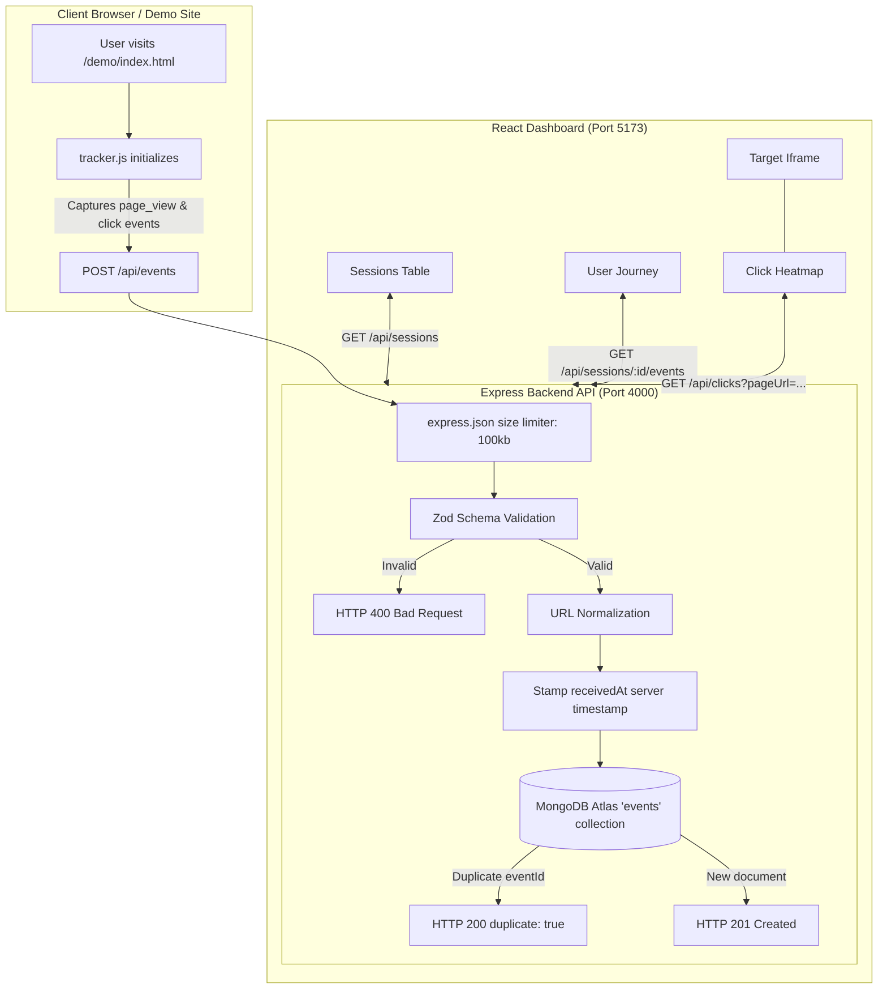
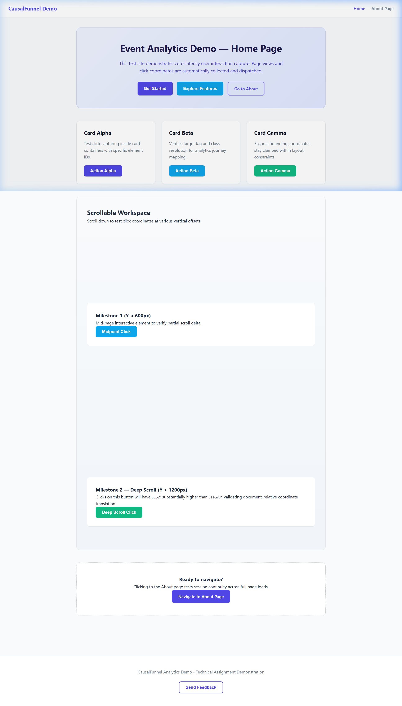
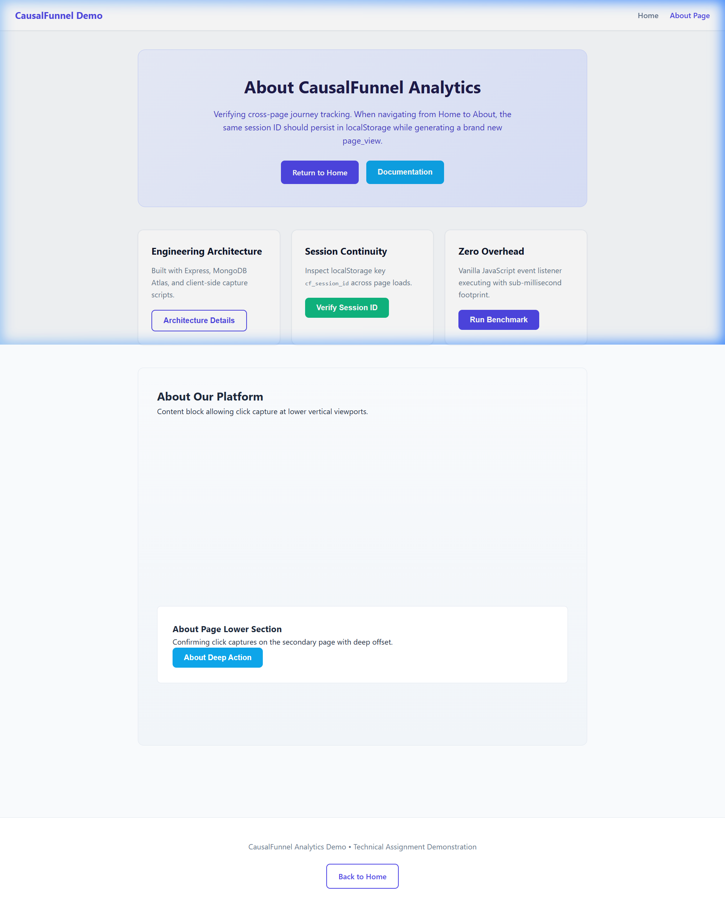
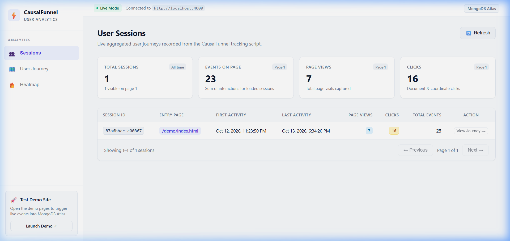
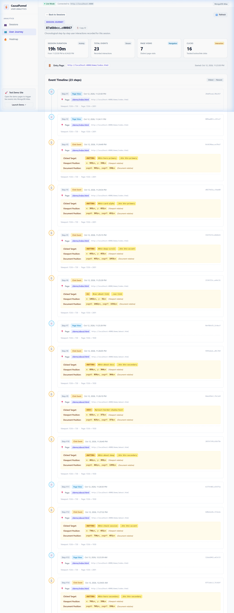
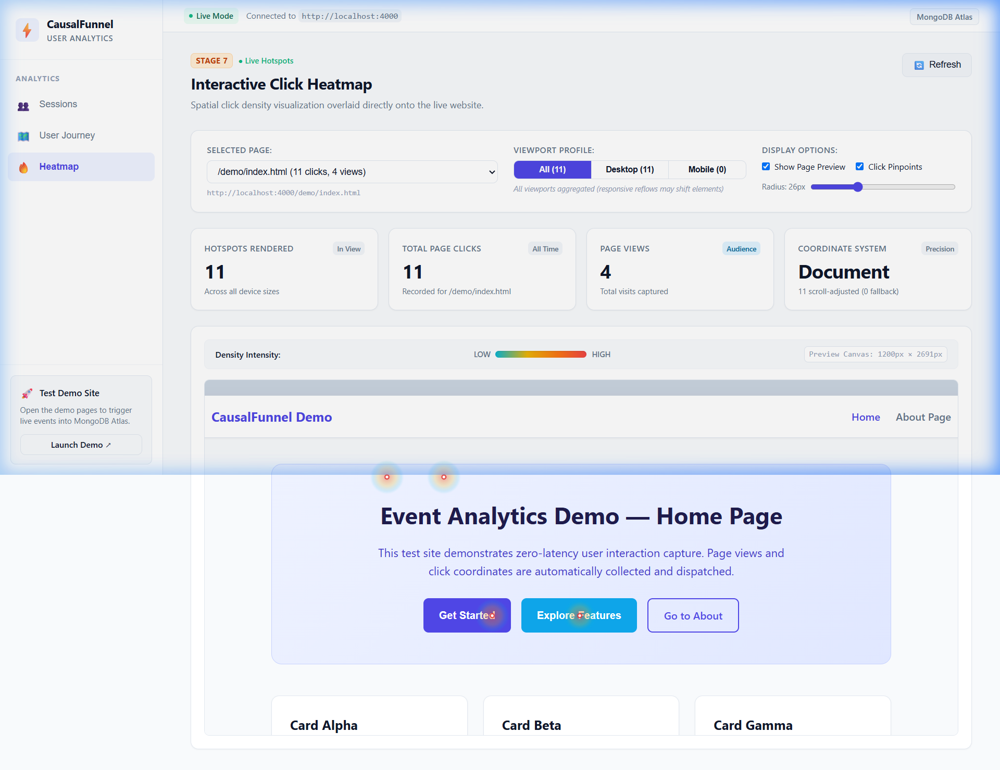

# CausalFunnel User Analytics

A resilient, lightweight, full-stack web analytics platform engineered for event ingestion, session journey tracking, and interactive spatial click heatmaps.

---

## Table of Contents

- [1. Purpose \& Overview](#1-purpose--overview)
- [2. Features Implemented](#2-features-implemented)
- [3. Technology Stack](#3-technology-stack)
- [4. Architecture \& Event Data Flow](#4-architecture--event-data-flow)
- [5. Repository Directory Structure](#5-repository-directory-structure)
- [6. Prerequisites](#6-prerequisites)
- [7. MongoDB Atlas Setup](#7-mongodb-atlas-setup)
- [8. Environment Variable Configuration](#8-environment-variable-configuration)
- [9. Local Installation \& Startup Commands](#9-local-installation--startup-commands)
- [10. Accessing the Demo Website \& Analytics Dashboard](#10-accessing-the-demo-website--analytics-dashboard)
- [11. API Endpoint Documentation](#11-api-endpoint-documentation)
- [12. Event Schema Explanation](#12-event-schema-explanation)
- [13. Testing Guide](#13-testing-guide)
- [14. Screenshots](#14-screenshots)
- [15. Engineering Assumptions \& Trade-offs](#15-engineering-assumptions--trade-offs)
- [16. Coordinate Normalization \& Responsive Heatmap Limitations](#16-coordinate-normalization--responsive-heatmap-limitations)
- [17. Known Limitations \& Troubleshooting](#17-known-limitations--troubleshooting)
- [18. Reviewer Clean Checkout Reproduction Guide](#18-reviewer-clean-checkout-reproduction-guide)

---

## 1. Purpose & Overview

**CausalFunnel User Analytics** is an end-to-end user activity tracking and visualization system. It allows website owners to embed a drop-in plain JavaScript tracking snippet that reliably captures user sessions, page views, and click interactions, stores them in MongoDB Atlas, and visualizes user behavior across:
- **Sessions Dashboard**: High-level aggregated session metrics, duration, and page activity.
- **Session Journey**: Chronological step-by-step user audit trails with element tags, timestamps, and scroll coordinates.
- **Interactive Click Heatmap**: Spatial density visualization with canvas heat gradients and pinpoint markers overlaid directly atop a live preview of the website.

---

## 2. Features Implemented

### Vanilla JS Tracker (`tracker/tracker.js`)
- **Zero Dependencies**: Pure, lightweight vanilla JavaScript (<10 KB unminified).
- **Iframe Guard**: Detects `window.self !== window.top` to prevent self-tracking when rendered inside the Heatmap preview iframe.
- **Double-Initialization Guard**: Employs `window.__CF_TRACKER_INITIALIZED__` flag.
- **Session Continuity**: Generates standard RFC4122 v4 UUIDs stored in `localStorage` under `cf_session_id`, with memory fallback for private-browsing modes.
- **High-Fidelity Coordinate Capture**: Captures both viewport coordinates (`clientX`, `clientY`) and document-relative coordinates (`pageX`, `pageY`), along with full viewport and document dimensions.
- **Automatic Event Transmission**: Uses `fetch` with `keepalive: true` and 1-attempt exponential retry on network/server errors.

### Ingestion Backend (`server`)
- **Strict Zod Validation**: Validates all incoming payloads before database operations.
- **URL Canonicalization**: Strips URL queries and anchor hash fragments (`?ref=...`, `#heading`) to group canonical pages accurately.
- **Idempotency & Duplicate Protection**: MongoDB unique index on `eventId`; retried requests return HTTP `200 { duplicate: true }` instead of failing.
- **Server Timestamp Authority**: Server generates `receivedAt` to guarantee trusted ordering irrespective of client clock drift.
- **Hardened Static Asset Serving**: Scoped delivery of `/tracker.js` and `/demo/*` with dotfiles denied (`dotfiles: 'deny'`) to prevent directory traversal and secret leaks.

### Analytics Read APIs (`server/src/routes`)
- `GET /api/sessions`: Aggregated sessions with total page views, clicks, duration, and entry page with server-side pagination.
- `GET /api/sessions/:sessionId/events`: Strict chronological event stream ordered oldest-first for journey reconstruction.
- `GET /api/pages`: Distinct page grouping with aggregate views and click counters.
- `GET /api/clicks`: Page-specific click retrieval capped at 5,000 documents with an explicit `meta.truncated` flag for browser performance.

### React Analytics Dashboard (`client`)
- **Sessions View**: Summary KPI cards, paginated session table, duration calculations, and direct navigation links to journey views.
- **Session Journey View**: Timeline audit trail with event badges (`PAGE VIEW`, `CLICK`), CSS selectors, document coordinates, and elapsed session time offsets.
- **Interactive Click Heatmap**: Dual-layer canvas overlaid on target webpage iframe, radial heat density gradients, pinpoint toggle, hotspot radius slider, and responsive viewport filtering (`All`, `Desktop`, `Mobile`).

---

## 3. Technology Stack

| Layer | Technology | Details |
|---|---|---|
| **Tracking Snippet** | Vanilla JavaScript (ES6+) | Plain JS, zero dependencies, RFC4122 UUID, capture-phase event listener |
| **Backend Framework** | Node.js (v20+), Express 5 | High-performance asynchronous HTTP REST API |
| **Database** | MongoDB Atlas, Mongoose 9 | Cloud document database with compound and unique indexes |
| **Validation** | Zod (v4) | Runtime schema validation for requests and query parameters |
| **Frontend Framework** | React 19, Vite 8 | Modern React architecture with native hooks and single-page routing |
| **Styling** | Vanilla CSS | Custom design system, dark glassmorphism palette, responsive layout |
| **Testing** | Node.js Test Runner (`node --test`) | Built-in test runner with native `node:assert/strict` assertions |

---

## 4. Architecture & Event Data Flow



---

## 5. Repository Directory Structure

```
causalfunnel-analytics/
├── .gitignore                     # Root gitignore (ignores .env, node_modules, build outputs)
├── README.md                      # Comprehensive project documentation
├── tracker/
│   └── tracker.js                 # Plain JavaScript tracking script
├── demo/
│   ├── index.html                 # Demo Home page with CTA and scroll sections
│   ├── about.html                 # Demo About page with session verification
│   └── demo.css                   # Demo site styling
├── server/
│   ├── .env.example               # Backend environment variable template
│   ├── package.json               # Backend dependencies and test scripts
│   ├── src/
│   │   ├── index.js               # Server entry point (starts server and connects DB)
│   │   ├── app.js                 # Express app configuration, middleware, and routes
│   │   ├── config/
│   │   │   ├── env.js             # Environment variable loader & validator
│   │   │   └── db.js              # Mongoose connection with safe host logging
│   │   ├── models/
│   │   │   └── Event.js           # Mongoose Event schema and indexes
│   │   ├── validators/
│   │   │   ├── eventSchema.js     # Zod schema for event ingestion & URL normalizer
│   │   │   └── querySchemas.js    # Zod schemas for query parameters & session IDs
│   │   ├── middleware/
│   │   │   ├── notFound.js        # 404 JSON catch-all handler
│   │   │   └── errorHandler.js    # Centralized error handler (hides internal leaks)
│   │   └── routes/
│   │       ├── health.js          # GET /api/health
│   │       ├── events.js          # POST /api/events
│   │       ├── sessions.js        # GET /api/sessions & GET /api/sessions/:id/events
│   │       ├── pages.js           # GET /api/pages
│   │       └── clicks.js          # GET /api/clicks
│   └── tests/
│       ├── unit/
│       │   ├── eventSchema.test.js
│       │   ├── querySchemas.test.js
│       │   └── trackerGuards.test.js
│       └── integration/
│           ├── events.test.js
│           ├── readApis.test.js
│           └── staticServing.test.js
├── client/
│   ├── .env.example               # Frontend environment variable template
│   ├── .gitignore                 # Client-specific gitignore
│   ├── package.json               # Frontend dependencies and test scripts
│   ├── vite.config.js             # Vite development and build configuration
│   ├── index.html                 # React SPA index HTML
│   ├── src/
│   │   ├── main.jsx               # React entry point
│   │   ├── App.jsx                # Layout, header, tab navigation, and routing
│   │   ├── index.css              # Glassmorphic CSS design system
│   │   ├── api/
│   │   │   └── client.js          # Centralized API fetch client with ApiError
│   │   ├── pages/
│   │   │   ├── SessionsPage.jsx   # Aggregated sessions table and summary cards
│   │   │   ├── JourneyPage.jsx    # Chronological user journey timeline
│   │   │   └── HeatmapPage.jsx    # Interactive click heatmap overlay
│   │   ├── components/
│   │   │   ├── LoadingState.jsx   # Accessible loading spinner
│   │   │   ├── ErrorState.jsx     # Structured error display with retry
│   │   │   └── EmptyState.jsx     # Friendly zero-data placeholder
│   │   └── utils/
│   │       ├── journeyUtils.js    # Date, duration, and URL formatters
│   │       └── heatmapUtils.js    # Coordinate math, viewport filters, canvas renderer
│   └── tests/
│       ├── apiClient.test.js
│       ├── sessionsView.test.js
│       ├── sessionJourney.test.js
│       └── heatmap.test.js
└── docs/
    └── screenshots/               # Verified application screenshots
```

---

## 6. Prerequisites

- **Node.js**: Version `20.18.0` or higher (verified on Node.js v24.x).
- **npm**: Version `10.x` or higher.
- **MongoDB Atlas Account**: A free MongoDB Atlas cluster connection URI (or local MongoDB 6+ instance).

---

## 7. MongoDB Atlas Setup

1. Log in to [MongoDB Atlas](https://www.mongodb.com/cloud/atlas).
2. Create a free shared cluster (e.g. M0 tier).
3. Under **Database Access**, create a user with `Read and write to any database` privileges.
4. Under **Network Access**, add IP Address `0.0.0.0/0` (Allow Access from Anywhere) or your current development machine IP.
5. In your cluster view, click **Connect** → **Drivers** (Node.js) and copy the connection string.
6. Replace `<username>`, `<password>`, and specify the database name (e.g. `/causalfunnel`).

Example URI pattern:
```
mongodb+srv://<username>:<password>@cluster0.xxxxx.mongodb.net/causalfunnel?retryWrites=true&w=majority
```

---

## 8. Environment Variable Configuration

### Backend (`server/.env`)
Create `server/.env` based on `server/.env.example`:

```bash
cp server/.env.example server/.env
```

Set the values:
```env
PORT=4000
MONGODB_URI=mongodb+srv://<username>:<password>@cluster0.xxxxx.mongodb.net/causalfunnel?retryWrites=true&w=majority
CORS_ORIGINS=http://localhost:5173,http://localhost:3000
NODE_ENV=development
```

> **Security Note**: Never commit `server/.env` to source control. It is strictly excluded by `.gitignore`.

### Frontend (`client/.env`)
Create `client/.env` based on `client/.env.example`:

```bash
cp client/.env.example client/.env
```

Set the value:
```env
VITE_API_URL=http://localhost:4000
```

> **Important**: In Vite, any variable prefixed with `VITE_` is compiled into the client-side JavaScript bundle and is visible to any browser user. Never store database credentials, server private keys, or passwords in `client/.env`.

---

## 9. Local Installation & Startup Commands

### Step 1: Install Dependencies
Open two terminal windows (or tabs):

```bash
# Terminal 1 — Backend
cd server
npm install

# Terminal 2 — Frontend
cd client
npm install
```

### Step 2: Start Backend Server
```bash
cd server
npm run dev
# or: npm start
```
*The server will connect to MongoDB Atlas and listen on `http://localhost:4000`.*

### Step 3: Start Frontend Dashboard
```bash
cd client
npm run dev
```
*The Vite development server will start on `http://localhost:5173`.*

---

## 10. Accessing the Demo Website & Analytics Dashboard

| Surface | URL | Description |
|---|---|---|
| **Demo Website (Home)** | `http://localhost:4000/demo/index.html` | Interactive landing page that triggers `page_view` and `click` events |
| **Demo Website (About)** | `http://localhost:4000/demo/about.html` | About page verifying session continuity across internal navigation |
| **Tracker Script** | `http://localhost:4000/tracker.js` | Standalone plain JavaScript tracker script |
| **Sessions Dashboard** | `http://localhost:5173/` or `/sessions` | Overview of all active visitor sessions, total views, and duration |
| **Session Journey** | `http://localhost:5173/sessions/:sessionId` | Step-by-step chronological audit trail for a specific visitor session |
| **Interactive Heatmap** | `http://localhost:5173/heatmap` | Visual spatial click density overlaid on live preview frame |

---

## 11. API Endpoint Documentation

### Health Check
- **`GET /api/health`**
  - **Status**: `200 OK`
  - **Response**: `{ "status": "ok", "timestamp": "...", "database": "connected" }`

### Event Ingestion
- **`POST /api/events`**
  - **Description**: Ingests a `page_view` or `click` event.
  - **Body limit**: 100 KB.
  - **Responses**:
    - `201 Created`: Document successfully persisted. `{ "data": { "eventId": "...", "duplicate": false } }`
    - `200 OK`: Duplicate event detected (idempotent). `{ "data": { "eventId": "...", "duplicate": true } }`
    - `400 Bad Request`: Schema validation error with detailed issue path.
    - `413 Payload Too Large`: Request body exceeds 100 KB.
    - `503 Service Unavailable`: MongoDB disconnected or unavailable.

### Read Analytics
- **`GET /api/sessions?page=1&limit=20`**
  - **Description**: Returns paginated session summaries sorted newest-first.
  - **Response**: `{ "data": [ { "sessionId": "...", "pageViews": 3, "clicks": 5, "durationSeconds": 42, "entryPage": "...", "firstSeen": "...", "lastSeen": "..." } ], "pagination": { "page": 1, "limit": 20, "total": 1 } }`

- **`GET /api/sessions/:sessionId/events`**
  - **Description**: Returns all events belonging to a session in chronological order (oldest first).
  - **Responses**: `200 OK` with `{ "data": [...], "meta": { "count": 8 } }`, or `404 Not Found` if session does not exist.

- **`GET /api/pages`**
  - **Description**: Returns all distinct tracked canonical pages with total views and clicks.
  - **Response**: `{ "data": [ { "pageUrl": "http://localhost:4000/demo/index.html", "pageViews": 12, "clicks": 28 } ] }`

- **`GET /api/clicks?pageUrl=...`**
  - **Description**: Returns click events for a specific normalized page URL for heatmap visualization.
  - **Limit**: Capped at 5,000 records.
  - **Response**: `{ "data": [...], "meta": { "count": 45, "truncated": false } }`

---

## 12. Event Schema Explanation

Each analytics document adheres to the following specification:

| Field | Type | Validation Rules | Description |
|---|---|---|---|
| `eventId` | String | Required, RFC4122 UUID v4 | Unique identifier used for idempotency and duplicate deduplication |
| `sessionId` | String | Required, 8–64 alphanumeric chars | Persistent session token stored in visitor's `localStorage` |
| `type` | String | Enum: `"page_view"` \| `"click"` | Type of interaction |
| `pageUrl` | String | Valid HTTP/HTTPS URL, max 2048 chars | Canonical page URL (query params and hash stripped) |
| `timestamp` | Date | ISO string, max 5 min into future | Client occurrence timestamp |
| `receivedAt` | Date | Generated by backend server | Authoritative server arrival timestamp |
| `viewport` | Object | `{ width: int > 0, height: int > 0 }` | Browser window inner dimensions |
| `pageDimensions` | Object | `{ width: int > 0, height: int > 0 }` | Total scrollable document dimensions |
| `click` | Object | Required for `type: "click"`, absent for `page_view` | Sub-schema containing click coordinates and element metadata |
| `click.x`, `click.y` | Number | Integer, clamped to `[0, viewport]` | Viewport-relative coordinates (`clientX`, `clientY`) |
| `click.pageX`, `click.pageY` | Number | Integer, >= 0 | Document-relative coordinates (`pageX`, `pageY`) |
| `click.target` | Object | `{ tag: string, id: string, class: string }` | Interacted HTML element attributes |

---

## 13. Testing Guide

The repository includes a comprehensive regression test suite with **130 automated tests (100% passing)**:
- **Backend**: 84 tests across 25 suites (Unit tests, MongoDB Atlas integration tests, duplicate handling, static serving security, and path traversal).
- **Frontend**: 46 tests across 9 suites (API client, session journey logic, coordinate normalization, viewport classification, and heatmap canvas rendering).

### Running Backend Tests
```bash
cd server
npm test
```
*Runs all unit and integration tests against the configured MongoDB Atlas database.*

Individual backend suites:
```bash
npm run test:unit           # Fast unit tests for Zod validators and tracker guards
npm run test:integration    # Atlas integration tests for ingestion, read APIs, and static serving
```

### Running Frontend Tests
```bash
cd client
npm test
```
*Executes all frontend utility, calculation, and API client tests.*

### Running Frontend Production Build
```bash
cd client
npm run build
```
*Validates Vite production asset bundling (`dist/index.html`, `dist/assets/*`).*

---

## 14. Screenshots

The following screenshots were captured directly from the live application during end-to-end verification:

### 1. Demo Website (Home)

*Interactive demo landing page (`/demo/index.html`) instrumented with `tracker.js`.*

### 2. Demo Website (About & Session Continuity)

*Secondary demo page (`/demo/about.html`) validating session persistence across internal link traversal.*

### 3. Sessions Dashboard

*Live dashboard (`/sessions`) aggregating sessions, view counts, click totals, and calculated durations.*

### 4. User Journey Timeline

*Chronological event stream (`/sessions/:sessionId`) displaying step-by-step user interactions, click targets, and coordinates.*

### 5. Interactive Click Heatmap

*Live heatmap overlay (`/heatmap`) rendering radial density gradients and pinpoint markers over the preview iframe.*

---

## 15. Engineering Assumptions & Trade-offs

1. **Idempotent 200 Response for Duplicate Events**:
   - *Decision*: When the tracker retries a request with an identical `eventId`, the server returns `HTTP 200 { duplicate: true }` rather than `409 Conflict` or `500 Server Error`.
   - *Rationale*: Network retries should succeed idempotently from the client's perspective without throwing client-side uncaught exceptions or polluting application error logs.
2. **Capping Heatmap Clicks at 5,000**:
   - *Decision*: `GET /api/clicks` enforces an upper bound of 5,000 documents and exposes `meta.truncated: true`.
   - *Rationale*: Loading unbounded hundreds of thousands of click coordinates would exhaust browser memory and degrade canvas rendering frame rates. 5,000 clicks provide more than sufficient statistical density for visual analysis while keeping performance instantaneous.
3. **Canvas 2D Radial Gradient Rendering**:
   - *Decision*: The heatmap utilizes native HTML5 2D Canvas radial gradients with additive alpha layering rather than heavy WebGL dependencies.
   - *Rationale*: Zero external dependencies, broad cross-browser compatibility, and instantaneous rendering speed.
4. **Iframe Preview for Heatmaps**:
   - *Decision*: Overlays canvas directly on top of the live page inside an iframe with the tracker's `window.self !== window.top` guard enabled.
   - *Rationale*: Avoids complex DOM reconstruction engines while ensuring preview interactions never generate spurious analytics events.

---

## 16. Coordinate Normalization & Responsive Heatmap Limitations

### Coordinate Systems
1. **Document-Relative Coordinates (`pageX`, `pageY`)**:
   - Normalized as `normX = pageX / pageDimensions.width` and `normY = pageY / pageDimensions.height`.
   - Reflects the exact location of a click across scrollable pages, accounting for vertical scrolling.
2. **Viewport-Relative Coordinates (`x`, `y`)**:
   - Normalized as `normX = x / viewport.width` and `normY = y / viewport.height`.
   - Used strictly as a fallback when recorded page dimensions are missing.

### Responsive Layout Limitations
- **Element Reflow**: On responsive websites, elements dynamically reflow, expand, collapse, or stack vertically as screen widths change. A click on a button at `(x: 800, y: 150)` on a desktop monitor may appear in a completely different document location or hamburger menu on a mobile phone (`width: 390`).
- **Mitigation via Viewport Profiles**:
  - The Heatmap implements viewport classification thresholds:
    - **Desktop**: `width >= 1024px` (rendered on a 1200px preview container).
    - **Mobile**: `width < 768px` (rendered on a 390px mobile container).
    - **Intermediate**: `768px <= width < 1024px` (tablets, included in "All" view).
  - Users can toggle between profiles to view click distribution corresponding strictly to that device category.

---

## 17. Known Limitations & Troubleshooting

- **Iframe Embedding Restrictions (`X-Frame-Options` / CSP)**:
  - If a tracked third-party website sets `X-Frame-Options: DENY` or restrictive `Content-Security-Policy: frame-ancestors`, the browser will block the iframe underlay in the Heatmap. The Heatmap includes an error boundary banner providing an "Open in New Tab" link while continuing to render heatmap points over the canvas.
- **Cross-Origin Development Notice**:
  - In local development, the demo site runs on `http://localhost:4000` while the React dashboard runs on `http://localhost:5173`. CORS is preconfigured on the backend to allow `http://localhost:5173`.
- **Database Readiness (`503 Service Unavailable`)**:
  - If MongoDB Atlas is waking up from a pause or network connectivity drops, the backend returns HTTP 503 instead of crashing. Verify your Atlas IP access list includes your current IP.

---

## 18. Reviewer Clean Checkout Reproduction Guide

To verify this application from a completely clean git checkout:

1. **Clone the repository**:
   ```bash
   git clone <repo-url>
   cd causalfunnel-analytics
   ```

2. **Configure Environment Variables**:
   - Copy `server/.env.example` to `server/.env` and paste your MongoDB Atlas connection string.
   - Copy `client/.env.example` to `client/.env` (`VITE_API_URL=http://localhost:4000`).

3. **Install Dependencies**:
   ```bash
   cd server && npm install
   cd ../client && npm install
   cd ..
   ```

4. **Execute Regression Test Suites**:
   ```bash
   # Run backend integration & unit tests
   cd server && npm test

   # Run frontend unit & logic tests
   cd ../client && npm test

   # Validate frontend production build
   npm run build
   cd ..
   ```

5. **Start Applications**:
   - Terminal 1: `cd server && npm run dev`
   - Terminal 2: `cd client && npm run dev`

6. **Generate Sample Events & Verify Dashboard**:
   - Open `http://localhost:4000/demo/index.html` in your browser.
   - Click buttons and navigate to the About page.
   - Open `http://localhost:5173/` to view the newly tracked sessions in real-time.
   - Navigate to `/heatmap` to observe click hotspots overlaid on the demo website.
